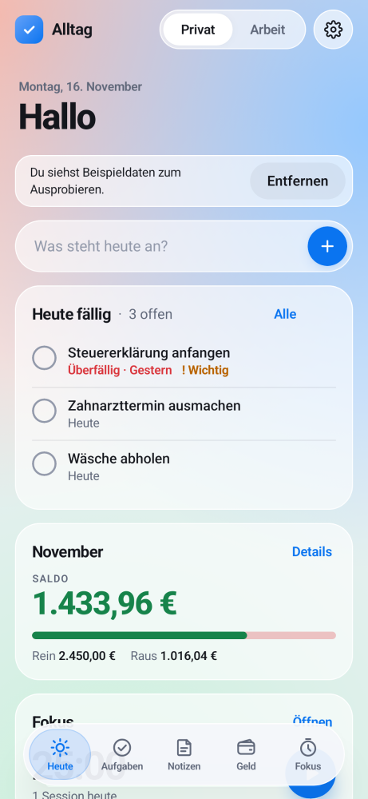
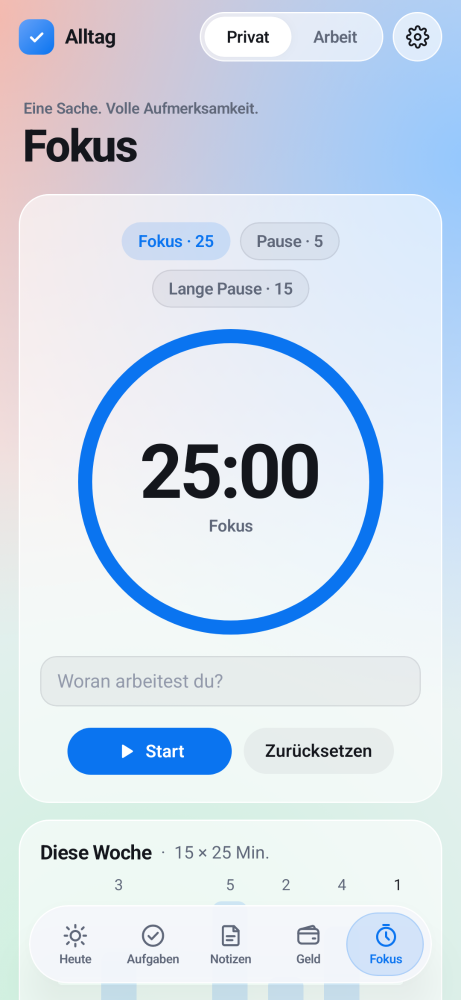

# Alltag

Die eine App für jeden Tag – privat und für die Arbeit.

- **Heute** – Begrüßung, fällige Aufgaben, Monatssaldo, Fokus-Timer, letzte Notiz
- **Aufgaben** – mit Fälligkeit und Wichtigkeit, gruppiert nach Überfällig / Heute / Morgen / Demnächst
- **Notizen** – mit Suche, speichern automatisch
- **Geld** – Einnahmen & Ausgaben pro Monat, Kategorien; im Bereich *Arbeit* mit geschätzter USt-Zahllast (19 %)
- **Fokus** – 25/5/15-Minuten-Timer mit Wochenübersicht

Oben umschalten zwischen **Privat** und **Arbeit** – jeder Bereich hat eigene Daten.
Alles bleibt lokal auf dem Gerät. Kein Konto, keine Cloud.

| Heute | Aufgaben | Notizen | Geld | Fokus |
|---|---|---|---|---|
|  |  |  |  |  |

## Android (nativ)

Kotlin + Jetpack Compose, Ordner [`android/`](android). Android 8.0 oder neuer.

- **Installieren:** [`Alltag.apk`](Alltag.apk) aufs Handy laden, öffnen, „Aus dieser Quelle installieren“ erlauben.
- **Selbst bauen:** `cd android && ./gradlew assembleRelease` → `app/build/outputs/apk/release/app-release.apk`
- Bei jedem Push baut GitHub Actions die APK automatisch (Tab *Actions* → *Alltag-apk*).

Extras auf Android: Benachrichtigung + Vibration, wenn der Fokus-Timer abläuft (auch wenn die App zu ist), Haptik beim Abhaken, Datumsauswahl, Android-Zurück-Geste, Themed Icon.

> Die APK ist mit einem Debug-Schlüssel signiert. Für den Play Store braucht es einen eigenen Signier-Schlüssel.

## Web

`index.html` im Browser öffnen. Auf dem iPhone in Safari → Teilen → *Zum Home-Bildschirm*.
